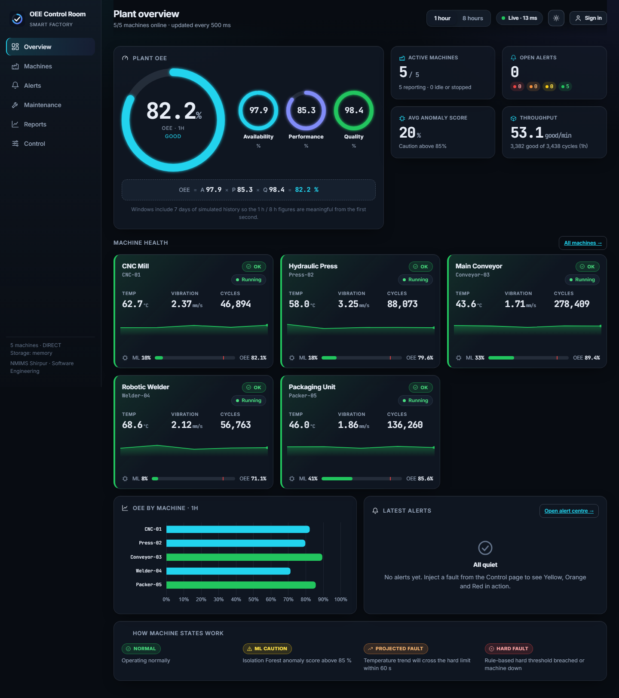

# AI-Enhanced Real-Time OEE & Anomaly Dashboard for a Smart Factory

Software-only smart-factory monitor: a Python **virtual factory** streams telemetry for 5-20 machines every 500 ms over **MQTT**, a **FastAPI** backend computes **OEE**, runs rule / **Isolation Forest** / **What-If regression** alerting, and a **React + Chart.js** dashboard shows everything live.

*Sanika Jamadar · B291 · Batch A2 · NMIMS Shirpur · Software Engineering · Guide: Dr. Naziya Hussain*



| Colour | Meaning | Source |
|---|---|---|
| 🟢 Green | Normal | – |
| 🟡 Yellow | ML caution – anomaly score > 85 % (2 ticks) | Isolation Forest |
| 🟠 Orange | Projected fault – least-squares line `y = m·x + c` over the last 3 min reaches the limit within 60 s (ETA shown) | What-If |
| 🔴 Red | Hard threshold breached (temp / vibration) or machine stopped | Rule engine |

## 5-minute quick start

### A) No Docker (fastest) – Windows
```powershell
powershell -ExecutionPolicy Bypass -File scripts\dev.ps1
```
Creates a virtual environment in `%USERPROFILE%\.venvs\oee` (outside OneDrive), installs packages, starts the backend (simulator built in) and the dashboard, and opens <http://localhost:5173>.

### A) No Docker – Linux / macOS
```bash
make setup      # once
make dev        # backend :8000 + frontend :5173
```

### B) Docker Compose (full path: Mosquitto → simulator → backend → nginx)
```bash
cp .env.example .env
docker compose up --build        # open http://localhost:5173
```
Databases are **off by default**. To have Compose run them too: `docker compose --profile db up --build` (set `STORAGE_MODE=db` and `POSTGRES_HOST_DOCKER=postgres`, `INFLUX_URL_DOCKER=http://influxdb:8086` in `.env`).

| URL | What |
|---|---|
| <http://localhost:5173> | Dashboard |
| <http://localhost:8000/docs> | OpenAPI / Swagger |
| `ws://localhost:8000/ws/live` | 500 ms live snapshot |
| <http://localhost:8000/metrics> | latency, inference time, WS clients, MQTT status |

**Sign in** (top right) with a demo account to make changes: `manager / manager123`, `engineer / engineer123`, `analyst / analyst123`, `admin / admin123` (set in `.env`, `USERS=`). Reading is open to everyone.

## Demo script (≈ 3 minutes)
1. Open **Control**, sign in as `manager`.
2. Pick `Welder-04` → **ML anomaly** → within ~3 s the tile turns **Yellow** (all values still below hard limits).
3. Move the speed slider to **×6**, pick `CNC-01` → **Temperature ramp**. Open the machine: the regression line steepens, **Orange** appears with an ETA countdown, then **Red** at 85 °C.
4. Pick `Press-02` → **Vibration spike** → instant **Red**.
5. Go to **Alerts**: acknowledge, assign a technician, resolve with notes, give 👍/👎 feedback on the Yellow caution; **Log maintenance** links the action to the alert.
6. **Reports** shows the 7-day OEE trend, downtime per shift and ML accuracy.
7. **Control → Simulate ML outage**: scores are held, Red rules keep working.

## Architecture
```
 simulator ──MQTT/WS──▶ Mosquitto ──▶ FastAPI ──▶ WebSocket ──▶ React dashboard
   ▲  factory/control ◀───────────────┘   │
                                          ├─▶ InfluxDB v2  (telemetry_raw 30 d, telemetry_agg 1 y)
                                          └─▶ PostgreSQL 14 (machines, users, alerts, maintenance, feedback)
```
`INGEST_MODE=mqtt|direct` (direct = simulator inside the backend, zero infrastructure) and `STORAGE_MODE=memory|db` are plain `.env` switches. See `report/figures/` for the UML and architecture diagrams.

## Databases (manual setup)
Follow `docs/DATABASE_MANUAL_SETUP_GUIDE.md`, then:
```bash
cd backend && python -m app.storage.verify      # writes/reads a test row + test point, tells you what is missing
# set STORAGE_MODE=db in .env and restart the backend
```
`db/postgres_schema.sql` is idempotent. `GET /health` reports `storage_mode`, `influx` and `postgres` separately. If a database is down the app keeps serving from memory and retries.

## Tests
```bash
cd backend && python -m pytest -q          # 28 tests: OEE, rules, What-If, ML, alerts, auth, API, WebSocket
cd frontend && npm run build && npm test   # type-check + production build + 7 Vitest tests
python scripts/smoke_test.py               # end-to-end: 5 machines, OEE, Orange->Red, Yellow, latency, inference, 50 WS clients
python scripts/mqtt_resilience_test.py     # real MQTT path, broker killed and restarted (reconnect <= 5 s)
```
Last measured results are in the report (Chapter 4). `python scripts/screenshots.py --mobile` regenerates all screenshots.

## Configuration (`.env`)
See `.env.example`: `INGEST_MODE`, `STORAGE_MODE`, `MACHINE_COUNT` (5-20), `BACKFILL_DAYS`, MQTT, Influx / Postgres, `ANOMALY_THRESHOLD`, `USERS`. No secrets are hard-coded.

## Project layout
```
simulator/   virtual factory + MQTT publisher        backend/app/  api, core, services, ml, storage, ws
frontend/    React + Vite + Chart.js                  db/           postgres_schema.sql, influx_setup.md
deploy/      mosquitto.conf                           scripts/      dev, smoke test, MQTT test, screenshots
docs/        SRS, templates, screenshots              report/       report (.docx/.pdf), diagrams
presentation/ slides (.pptx)
```

## Troubleshooting
| Symptom | Fix |
|---|---|
| Dashboard shows “Reconnecting…” | Backend not running on :8000 (`/api` is proxied to it). |
| `python -m app.storage.verify` fails | Container not running (`docker ps`), wrong `.env` values, or the schema was not applied (see the guide). |
| MQTT mode: no data | Broker not reachable; check `MQTT_HOST/PORT/TRANSPORT`. The dev broker `scripts/dev_broker.py` is for tests (use `MQTT_TRANSPORT=tcp`; its WebSocket listener drops idle connections, Mosquitto does not). |
| `npx` fails with a `COMSPEC` / JDK path error (Windows) | Set `COMSPEC=C:\Windows\System32\cmd.exe` in your shell. |
| First start is slow | The Isolation Forest is trained once (~5 s) if `backend/models/model.pkl` is missing; the 7-day back-fill takes ~3 s. |
| Project in OneDrive is slow to sync | `node_modules` has tens of thousands of files; keep the venv outside OneDrive (dev.ps1 does) and consider excluding `frontend/node_modules`. |

## Notes / deviations from the SRS
* **What-If** is both a manual 3-minute scenario (as in the SRS) *and* a continuous projection on every machine.
* Authentication is HTTP Basic with a `/auth/login` check (the SRS says “login/session”); credentials are held in `sessionStorage`.
* History older than the current session is **simulated back-fill** (labelled in the UI) unless databases are enabled.
